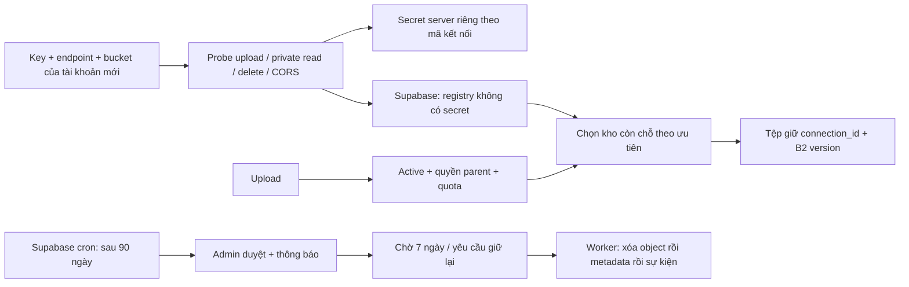
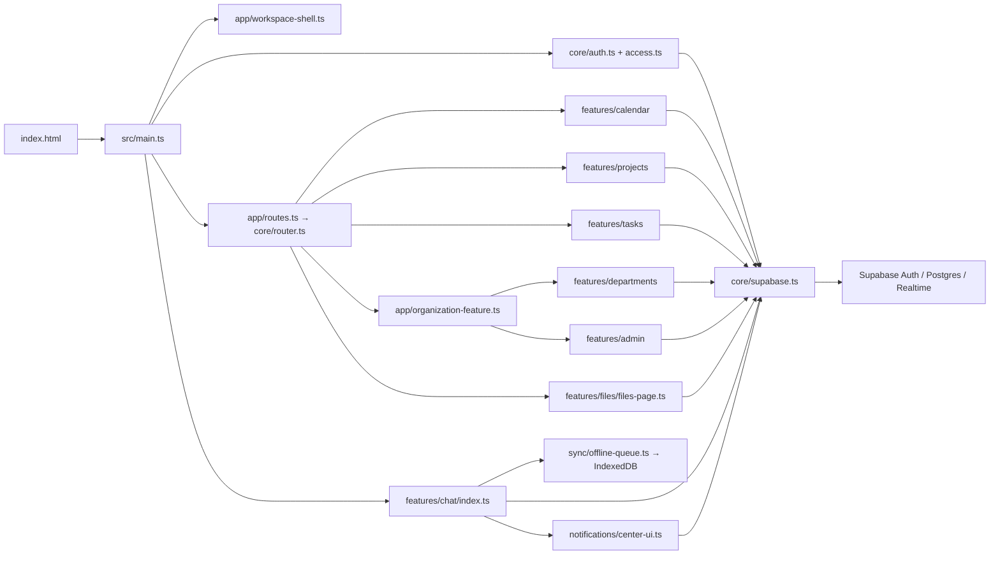
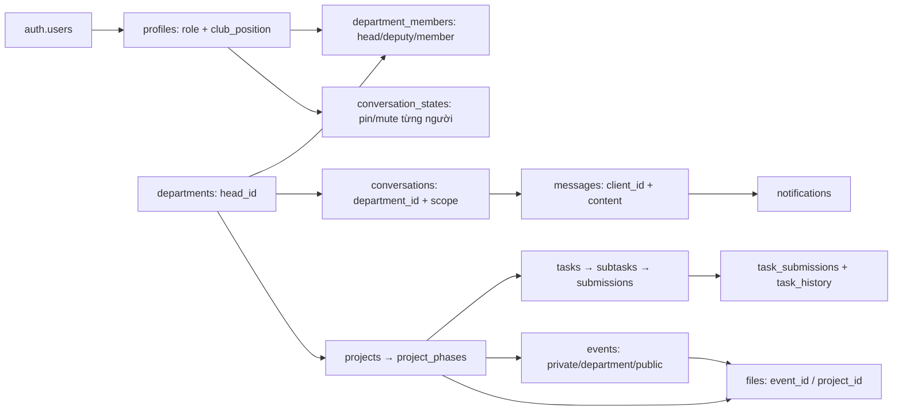
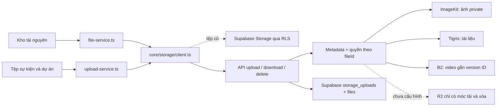
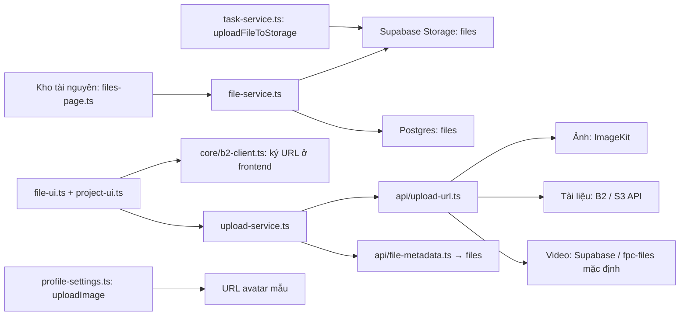
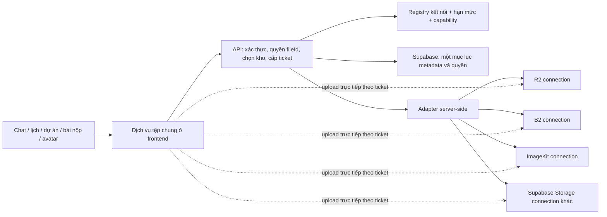

# FPC HUB v15 — bản đồ dự án

> **Deploy Netlify — 17/11/2026:** Netlify đã deploy ready: https://fpc-hub-v15.netlify.app, commit app e0a5245, deploy 6afc296e4f54d342bbf7c7aa. Gateway và storage-maintenance Node 22 có thật; cron 02:05 UTC = 09:05 Asia/Bangkok. HTTP smoke đang bị Netlify team login toàn site chặn, chưa xác minh API cloud. Chờ chủ dự án duyệt chuyển SSO sang chỉ non-production; chưa thay đổi access-control. 171 unit pass; fixture cloud thất bại ở gate đã dọn, 0 test user và 0 retention job thật. Xem docs/NETLIFY_DEPLOY.md.

> **Release Netlify đang chuẩn bị:** netlify.toml → gateway (5 API, cùng quyền cũ) và scheduled storage-maintenance 09:05. Netlify Free không tách scope Functions: dùng environment production mặc định cho build/server theo lựa chọn đã được giao, không đưa secret vào VITE_. 171 unit pass; chưa xác minh deploy. Điểm sửa/tiếp tục: docs/NETLIFY_DEPLOY.md. Site fpc-hub-v15.netlify.app đã tạo trong team Free; 20 biến production đã đồng bộ sau chấp thuận và lựa chọn Free. Helper sync-netlify-env mặc định chỉ lập kế hoạch. Repo hiện có origin GitHub; release dùng nhánh codex/netlify-deploy, không force-push main.

> **Kho xoay đã triển khai — 17/11/2026:** Supabase registry nhiều tài khoản, quota cá nhân, duyệt xóa + notifications live. App Kho tài nguyên có bảng quản trị. scripts/connect-storage.mjs kiểm tra key/endpoint/bucket rồi thêm tài khoản mới không sửa source; xem docs/STORAGE_CONNECT.md. 80% cảnh báo, 90% chọn kho kế tiếp; tệp cũ giữ connection_id. Supabase nhắc hằng ngày 09:00; worker xóa có thật nhưng cron Vercel cần deploy. DB 52 assertion, unit 159, API 68 check gồm admin đã đạt. Không có dữ liệu thật bị xóa.

> **Ba kho đã chạy local — 17/11/2026:** ảnh → ImageKit private; tài liệu → Tigris; video → B2 FPCBackbalaze. Khóa B2 mới FPC-HUB-storage giới hạn bucket/prefix fpc-hub/, secret lưu thẳng local, khóa cũ không bị xóa. B2 lưu storage_version do provider trả và tải/xóa theo đúng version; replay không đổi tệp đã chấp nhận. DB migration version pin + validation đã apply. API thật 43 check và DB 27 assertion đạt, preflight B2 200. Chưa deploy production. Các ghi chú B2 401/chưa bật bên dưới là lịch sử khóa cũ.

> **Kiểm tra B2 trên Chrome 17/11/2026:** bucket FPCBackbalaze private, encryption enabled, endpoint s3.eu-central-003.backblazeb2.com; đã lưu endpoint/region/bucket local, chưa bật routing B2. Dashboard xác nhận keyID của FPCB2 khớp local, chưa hết hạn nhưng namePrefix=FPCB2 không khớp fpc-hub/... của app và có quyền quản trị rộng. Secret local bị authorize 401. Chưa tạo/xóa khóa; cần khóa mới giới hạn đúng bucket và prefix phù hợp.

> **Kho đã nối local — 17/11/2026:** Kho chung/Lịch/Dự án dùng cùng phiếu upload server; ảnh ImageKit private, tài liệu/video Tigris. Supabase lưu metadata/session, chặn client và API service cũ chèn metadata không có phiếu. Hai migration storage đã apply live; DB test 23 assertion, test API thật 28 check đạt, fixture đã dọn. B2 authorize 401 nên chưa bật. API local đã chạy; chưa deploy Vercel/cron production và chưa thay khóa đã qua chat. Xem [trạng thái, kiến trúc, kiểm thử và việc còn lại](docs/STORAGE_READY_STATUS.md). Ghi chú “chưa nối/chưa test” bên dưới là lịch sử trước bước này.

> **ImageKit local 17/11/2026:** đã lưu private/public key FPCimagekit và IMAGEKIT_URL_ENDPOINT=https://ik.imagekit.io/fpchub trong .env.local (Git ignored), không ghi giá trị khóa vào tài liệu. API liệt kê tệp chỉ đọc trả HTTP 200, xác thực thành công; chưa test upload, quyền truy cập ảnh qua endpoint hoặc deploy. Cần thay private key trước dùng chính thức vì đã qua chat.

> **Tigris CLB 17/11/2026:** khóa FPC-HUB có Editor chỉ trên fpc-hub, default permissions disabled, đã đọc lại CLI xác minh. Đã PASS HeadBucket, upload tệp thử riêng, download đối chiếu nội dung, delete và HeadObject 404; bucket dùng soft delete 7 ngày nên phiên bản có thể còn trong thời gian giữ. Đã lưu TIGRIS_STORAGE_BUCKET=fpc-hub cùng nhóm TIGRIS_STORAGE_* trong .env.local (Git ignored). Chưa nối routing app hoặc deploy; ACL public chưa xác minh. Khóa đã qua chat cần thay trước dùng chính thức. Tài khoản CLB tách bucket khảo sát trong lịch sử bên dưới.

> **B2 local 17/11/2026:** đã lưu cặp khóa FPCB2 vào biến server B2_KEY_ID/B2_APPLICATION_KEY trong .env.local (Git ignored); không ghi giá trị khóa vào map. Chưa xác minh bucket/endpoint/quyền hay test kết nối, chưa deploy. Khóa đã được gửi qua chat nên cần thay trước sử dụng chính thức.

> **Tinh gọn menu cài đặt:** bỏ tiêu đề dư, Sáng/Tối nằm cùng hàng Giao diện; giảm khoảng đệm và bóng đổ, giữ nguyên các hành động tài khoản.

> **Cài đặt 17/11/2026:** bánh răng sidebar mở menu nổi Thông tin tài khoản → hồ sơ hiện có; Sáng/Tối → core/theme và localStorage; Đăng xuất → core/auth.handleLogout. Điểm sửa: features/settings/settings-menu.ts, settings-menu.css, profile-settings.ts. Menu đóng khi bấm ngoài/Escape, hỗ trợ bàn phím.

> **UI 17/11/2026:** bỏ nút Tạo mới/Tin nhắn ở header và FAB chat; giữ Thông báo, mở chat qua mục Tin nhắn trong sidebar. Điểm sửa: index.html và src/app/workspace-shell.ts. Cách tạo trong từng module giữ nguyên. Nếu cần khôi phục, thêm lại đúng hai nút HTML và đoạn tạo opener trong shell; không thay logic chat/auth.

> **Task/audit — 16/11/2026, đã áp dụng live:** [task_assignment_audit_guard](db/migrations/20261116082005_task_assignment_audit_guard.sql) + [work_review_audit_boundary](db/migrations/20261116082333_work_review_audit_boundary.sql). Task/subtask yêu cầu lãnh đạo active hoặc trưởng đúng ban, creator theo session, chặn đổi cha/ban trái quyền. History không cho client INSERT/UPDATE/DELETE; DB trigger sinh từ thay đổi thật trên task/subtask/bài nộp/nghiệm thu; frontend đã bỏ logHistory. Bài nộp bắt đầu chưa chấm/chưa duyệt, đúng người được giao/head; reviewer/time lấy từ session/server. [Test DB](db/tests/task_assignment_audit_guard.sql) chạy transaction ROLLBACK. API file-metadata và rotation khóa service-role vẫn là finding riêng chưa sửa. Xem [trạng thái chi tiết](docs/CLUB_ACCESS_STATUS.md).

> **Bảo mật 16/11/2026 — đã áp dụng live:** migration [20261116074915_collaboration_active_read_guard.sql](db/migrations/20261116074915_collaboration_active_read_guard.sql) thêm restrictive SELECT guard cho 8 bảng dự án/công việc/bài nộp/lịch sử/tệp; chỉ profile active được đọc, giữ nguyên permissive scope cũ. [Test DB](db/tests/collaboration_active_read_guard.sql): 40 kiểm tra qua 5 trạng thái × 8 bảng trong transaction ROLLBACK đạt; chat/event policies giữ nguyên fingerprint. SQL 0008 vẫn chưa áp dụng live; guard mới độc lập với 0008. Không kết luận đã xử lý mọi finding hoặc đã rotate service-role key. Khi sửa tiếp, dùng CRG định vị trước; mục này chỉ giữ trạng thái triển khai/khôi phục.

> **Quay lại guard này:** không có dữ liệu bị migrate hay xóa. Nếu lỗi hợp lệ, kiểm tra quyền SELECT profile và policy `collaboration_active_read_guard` trước; ưu tiên sửa guard. Chỉ rollback bằng migration riêng DROP đúng policy này trên đúng 8 bảng sau khi chặn truy cập người chưa duyệt bằng biện pháp khác, vì bỏ guard sẽ mở lại finding. Không chạy down/reset toàn DB hoặc áp dụng lại các patch Security cũ.

> **Cập nhật khóa Tigris:** người dùng đã tạo `fpc-hub-v15-server`; đã quan sát màn Access key created, endpoint S3 `https://t3.storage.dev`, IAM `https://iam.storage.dev`, region `auto`. Chưa lưu secret vào môi trường server, chưa xác minh/tắt default allowed operations hoặc cấp quyền bucket; chưa thử kết nối. Mọi ghi chú “chưa tạo access key” bên dưới là lịch sử trước bước này. Không ghi secret/ID khóa vào tài liệu.

> **16/11/2026 — Tigris:** đã kiểm tra dashboard tài khoản khảo sát và tạo bucket private `fpc-hub-v15-khaosat`, endpoint `https://t3.storage.dev`. Chưa tạo access key, chưa nối ứng dụng, chưa test upload/tải/xóa; không thêm thẻ hoặc bật trả phí. Chờ xác nhận tạo khóa giới hạn bucket. Không ghi secret vào map.

> Đọc đầu mỗi phiên. Đối chiếu mã nguồn ngày **15/11/2026**. Đây là bản đồ local, không phải xác nhận cấu hình production.
> Mục tiêu: khoảng 60 tài khoản / 15 người dùng thường xuyên; không thuê máy chủ, không phí duy trì cố định; tận dụng nhiều kho miễn phí qua một đầu mối.

> **S1 local:** đã gom kho tài nguyên và tệp sự kiện/dự án vào `src/core/storage/`. Mở [bản đồ trực quan](docs/PROJECT_MAP.html); xem [kiểm tra và cách quay lại](docs/STORAGE_CHANGELOG.md). Sau mỗi sửa mã/config/schema, rà soát map rồi chạy `npm run map:update` và `npm run map:check`. Build chặn map cũ; hash không thay thế việc cập nhật mô tả.

## 1. Định vị trong 60 giây

| Cần hiểu | Mở đúng chỗ |
|---|---|
| Luật dự án | [docs/AI_CONTEXT.md](docs/AI_CONTEXT.md): giữ Vanilla TS + Vite; port v14, không rewrite; không tự thêm dependency |
| Điểm khởi động | [src/main.ts](src/main.ts) → đăng nhập → router + shell + chat |
| Trang nào nối module nào | [src/app/routes.ts](src/app/routes.ts), [src/core/router.ts](src/core/router.ts) |
| Quyền người dùng | [src/core/access.ts](src/core/access.ts), [src/core/auth.ts](src/core/auth.ts); quyền thật nằm ở SQL/RLS |
| Hợp đồng dữ liệu | [src/core/types.ts](src/core/types.ts), types trong từng feature; đối chiếu `db/migrations/` trước sửa service |
| Giao diện chung | [src/app/workspace-shell.ts](src/app/workspace-shell.ts), [src/app/workspace.css](src/app/workspace.css), [src/app/minimal-theme.css](src/app/minimal-theme.css) |
| Điểm rối cần xử lý trước lưu trữ | **Mục 4**: hiện có nhiều đường upload/tải/xóa độc lập |
| Kiến trúc đa kho cần xây | **Mục 5** — đề xuất, chưa triển khai |
| Đang thiếu gì | **Mục 7** — đặc biệt SQL 0008 và Edge Function chưa xác nhận deploy |

Root làm việc: `E:/f-code-studio/projects/fpc-hub-v15`, có Git riêng. `_ai/` ở root studio là tài liệu AI cũ; `workspace/sandbox/` là thử nghiệm. Không quét kho archive/Ghidra/node_modules để tìm hiểu app.

## 2. Bản đồ chạy thật trong mã

Codex và plugin Supabase là công cụ phát triển, không phải thành phần người dùng cần mở để app chạy. Web production dự kiến dùng Vercel; `api/` là serverless, `supabase/functions/` là Edge Function. Không cần PC Sếp bật liên tục sau khi deploy. Tình trạng deploy hiện tại chưa kiểm tra.

| Đường vào | Bộ điều phối → giao diện/service | Dữ liệu chính |
|---|---|---|
| `#/` | `calendar/index.ts` → `calendar-ui.ts`, `event-modal.ts`, `calendar-service.ts` | `events`, `tasks`, `projects`, `departments` |
| `#/projects` | `projects/feature.ts` → `index.ts`, `project-ui.ts`, `project-service.ts` | `projects`, `project_phases`, `project_reports`, `tasks`, `files` |
| `#/tasks` | `tasks/feature.ts` → `index.ts`, `task-ui.ts`, `task-workflow.ts`, `task-service.ts` | `tasks`, `subtasks`, `submissions`, `task_submissions`, `task_history` |
| `#/departments` | `app/organization-feature.ts` → `departments/index.ts` + `admin/index.ts` | `departments`, `department_members`, `profiles` |
| `#/admin` | Alias cùng màn Tổ chức & quản trị | Không còn mục quản trị riêng trong menu |
| `#/files` | `files/feature.ts` → `files-page.ts` → `file-service.ts` | `files` + Supabase Storage bucket `files` |
| Nút Tin nhắn | `chat/index.ts` → `chat-ui.ts`, `chat-service.ts`, `service/messages.ts` | `conversations`, `conversation_states`, `messages`, `profiles_public` |
| Avatar / cài đặt | `settings/profile-settings.ts` → `utils/avatar.ts`, `core/theme.ts` | `profiles`, cài đặt CLB, localStorage theme |

Các tên feature trong bảng là đường dẫn dưới `src/features/`. Chat giữ state riêng trong `chat/index.ts`; lịch giữ state riêng trong `calendar/index.ts`; `core/store.ts` còn phục vụ phần port cũ. Không mặc định mọi màn đều dùng Store.

## 3. Quyền và quan hệ dữ liệu

- `role=admin/super_admin` hoặc `club_position=president/vice_president`, đã active: quản lý tổ chức/bổ nhiệm. Trưởng ban không tự thành admin CLB.
- Scope chat: `direct/group` theo `members`; `department` theo membership ban; `club` mọi thành viên active đọc, lãnh đạo CLB đăng thông báo.
- Lịch: checkbox cá nhân / ban / CLB trộn cùng một lưới; Ngày/Tuần/Tháng là cách xem, không phải kho dữ liệu khác nhau. RLS phải giới hạn trước, checkbox chỉ điều khiển hiển thị.
- SQL 0008 dự kiến đồng bộ `head_id` và membership, tạo chat ban/CLB, khóa đọc chéo. **Chưa áp dụng live**; xem [docs/CLUB_ACCESS_STATUS.md](docs/CLUB_ACCESS_STATUS.md).

## 4. Bản đồ lưu trữ hiện tại — ba kho đã kiểm chứng local

- `src/core/storage/types.ts`: hợp đồng provider/path/bucket, tương thích tệp cũ; provider lạ báo lỗi.
- `client.ts`: hub/lịch/dự án dùng chung phiếu server và finalize. Server chọn ảnh ImageKit, tài liệu Tigris, video B2 bằng cấu hình; không chuyển kho im lặng khi lỗi. Giữ đường đọc tệp cũ.
- `api/_lib/storage.ts` + `storage-policy.ts`: đọc metadata thật trước tải/xóa kho ngoài; kiểm tra active, quyền sự kiện/dự án; xóa giới hạn người upload. Supabase `files` dùng Storage RLS trực tiếp, cần kiểm chứng chính sách live.
- `core/b2-client.ts` chỉ còn shim gọi gateway, không còn ký URL bằng secret frontend. API video không còn trả public URL. ImageKit đã công khai từ trước không tự trở thành private.
- `file-metadata.ts` xác minh object và finalize qua RPC service-only, kiểm tra lại parent/active, row lock chống tạo trùng. B2 pin storage_version; tải/xóa đúng version. Có quota nội bộ và cleanup phiếu hết hạn/bản B2 replay, chưa có registry nhiều tài khoản hoặc upload R2. Tệp nộp bài/avatar chưa chuyển. Xem docs/STORAGE_READY_STATUS.md.

### Mốc trước S1 — chỉ để đối chiếu, không phải đường chạy hiện tại

Đây là sơ đồ **mã nguồn**, chưa chứng minh từng nhà cung cấp đã được cấu hình/chạy thành công. Chưa thấy adapter R2 riêng; có S3 SDK nên có thể bổ sung nhưng không được ghi R2 đã nối xong.

| Điểm nối | Thực trạng cần biết trước khi sửa |
|---|---|
| [upload-service.ts](src/features/files/upload-service.ts) | Ảnh → ImageKit, video → Supabase, tài liệu → B2; lựa chọn kho đang hard-code theo loại tệp |
| [file-service.ts](src/features/files/file-service.ts) | Màn kho chung dùng Supabase trực tiếp cho mọi loại; có `storage_provider` nhưng tải/xóa vẫn chỉ Supabase |
| [files/index.ts](src/features/files/index.ts) | Barrel export `upload-service` và `file-ui`; dự án còn import chéo qua đây |
| [file-ui.ts](src/features/files/file-ui.ts) / [project-ui.ts](src/features/projects/project-ui.ts) | Có đường gọi B2 cũ và Store; không chỉ sửa màn `/files` rồi cho rằng mọi nơi đã đổi |
| [task-service.ts](src/features/tasks/task-service.ts) | Nộp bài upload Supabase riêng, dùng `getPublicUrl`; cần chuyển cùng đầu mối tệp |
| [api/upload-url.ts](api/upload-url.ts) | Cấp quyền upload B2/ImageKit/Supabase; video còn trả public URL |
| [api/download-url.ts](api/download-url.ts) | Hiện nhận `storagePath` để ký B2; chưa đối chiếu quyền tệp theo `fileId` |
| [api/file-delete.ts](api/file-delete.ts) | Chọn nhà cung cấp từ `kind`; cần đọc provider từ metadata đáng tin cậy và kiểm tra quyền |
| [api/file-metadata.ts](api/file-metadata.ts) | Ghi bằng admin client; payload chưa ghi rõ connection/provider. Cần xác minh object và quyền hồ sơ cha |
| [core/b2-client.ts](src/core/b2-client.ts) | Đọc `VITE_B2_*` và ký URL frontend: cần loại đường dùng secret trên trình duyệt, không chép giá trị khóa vào map |
| [calendar/feature.ts](src/features/calendar/feature.ts) | Phát `fpc:quick-upload`; chưa thấy listener trong `src/`, cần nối vào dịch vụ tệp trước khi báo kéo-thả hoạt động |
| [profile-settings.ts](src/features/settings/profile-settings.ts) | `uploadImage` còn trả URL mẫu; chưa nối pipeline upload avatar thật |

`files` đã có `storage_provider`, `storage_path`, `mime_type`, `size`, `uploaded_by`, `project_id`, `event_id` trong type local. Hai luồng ghi metadata khác nhau; phải đọc schema live và backfill có kiểm chứng, không suy đoán provider chỉ từ đuôi tệp.

`npm run dev` chỉ chạy Vite; [vite.config.ts](vite.config.ts) chưa cấu hình proxy `/api`. Test trang local không đồng nghĩa API Vercel chạy local. [vercel.json](vercel.json) có lịch gọi `/api/heartbeat`; chưa xác minh cron production.

## 5. Bản đồ ĐÍCH — nhiều kho, một trải nghiệm

**S1 đã tạo hợp đồng/client `src/core/storage/` và helper `api/_lib/storage.ts`. Chưa tạo registry nhiều tài khoản/quota.** Giữ API hiện có làm điểm vào để port từng luồng, không rewrite. Sơ đồ trên là đích hoàn chỉnh, không phải trạng thái đã deploy.

1. **Một mục lục, nhiều kho:** nội dung tệp phân bổ nhiều nền tảng/tài khoản; metadata và quyền dùng một nguồn chính. Nhiều Gmail = nhiều `connection_id`, không phải nhiều hệ đăng nhập người dùng.
2. **Mỗi tệp có địa chỉ ổn định:** `file_id`, `provider`, `connection_id`, `object_key`, loại/MIME, bytes, owner và hồ sơ cha. UI giữ `file_id`; không lưu signed URL sắp hết hạn làm địa chỉ vĩnh viễn.
3. **Chọn kho một lần:** API xét capability, dung lượng được cấp, phần đã dùng/đang dành chỗ, tình trạng kết nối. Không gửi thử cùng lúc vào mọi tài khoản; không hỏi mọi provider mỗi lần mở lịch/chat.
4. **Upload trực tiếp:** client nén ảnh nếu phù hợp → API cấp ticket theo quyền → truyền tệp thẳng đến kho → server xác minh kết quả → ghi metadata `ready`. Backend không chuyển tiếp toàn bộ video nếu không cần.
5. **Không có tệp ma:** vòng đời `pending/uploading/ready/failed/deleting`; retry giữ cùng mã, có dọn object mồ côi. Upload thất bại không tạo tin nhắn giả đã đính kèm thành công.
6. **Tải/xóa theo fileId:** server đọc đúng connection từ metadata và kiểm tra quyền trước khi ký URL/xóa. Tệp cũ ở kho cũ, đổi router không làm mất đường dẫn.
7. **Giữ giao diện mượt:** thumbnail nhỏ, lazy-load ảnh/video, cache URL đến gần hết hạn, upload có tiến trình/hủy/thử lại, giới hạn số tệp truyền song song. Không preload video trong danh sách chat.
8. **Hết quota mới chuyển kho:** chỉ chuyển trước khi upload hoặc sau thất bại đã xác định, không nhân bản ngoài ý muốn. Giữ nguyên số lượng/quyền file, báo rõ nếu tất cả kho hết mức miễn phí.
9. **Miễn phí có kiểm soát:** không tự nâng gói; hạn mức cấu hình theo từng tài khoản và ngày kiểm tra, dự trữ phần an toàn, theo dõi cả bytes/requests/băng thông. Nhiều tài khoản không mặc định được cộng quota; kiểm tra chính sách nhà cung cấp lúc nối.
10. **Secret chỉ ở server:** registry giữ tên tham chiếu secret, không chứa key/token trong dữ liệu client. Kết nối có thể tắt/đổi khóa mà không sửa từng feature.

Tài liệu kỹ thuật đối chiếu: [R2 presigned URL](https://developers.cloudflare.com/r2/api/s3/presigned-urls/). Các hạn mức miễn phí phải kiểm tra lúc cấu hình, không chốt bằng thông tin cũ trong map.

## 6. Sửa gì thì đọc/sửa đâu

| Yêu cầu | Điểm sửa chính | Phải đối chiếu / kiểm tra kèm |
|---|---|---|
| Màu, chữ, scrollbar | `app/minimal-theme.css` | CSS cũ `public/css/` có nhiều `!important`; sáng/tối, desktop/mobile |
| Chat cạnh lịch / phóng lớn | `app/workspace-shell.ts`, `workspace.css` | `chat/index.ts`, `chat-drag.ts`; chuyển trang không mất hội thoại |
| Trưởng/phó CLB, quản trị | `core/access.ts`, `auth.ts`, `app/organization-feature.ts`, `admin/service.ts` | `profiles.club_position`, SQL/RLS; không chỉ ẩn nút |
| Ban, trưởng ban, membership | `departments/index.ts`, `service.ts`, `view.ts` | `departments.head_id`, `department_members`; quyền chat/lịch sau gỡ người |
| Gửi tin / media / trạng thái | `chat/service/messages.ts`, `types.ts`, `chat-ui.ts`, `index.ts` | `messages` schema, offline dedup, bubble UI; service hỗ trợ không có nghĩa UI đã đủ |
| Mất mạng / tải bù | `chat/sync/offline-queue.ts`, `incremental.ts`, `status-monotonic.ts` | IndexedDB theo user, cursor, đăng xuất, không lùi trạng thái |
| Thông báo | `chat/notifications/` + `supabase/functions/chat-notifications/index.ts` | Secret webhook, mute, membership, duplicate; cần deploy riêng |
| Lịch / checkbox / sự kiện | `calendar/calendar-ui.ts`, `index.ts`, `event-modal.ts`, `calendar-service.ts` | `events.visibility`, RLS, tạo/sửa/xóa và quyền lịch ban |
| Dự án / tiến độ | `projects/project-service.ts`, `project-ui.ts` | `project_phases`, task, report; tiến độ thủ công/được tính phải rõ |
| Nộp bài / chấm / duyệt | `tasks/task-workflow.ts`, `task-service.ts` | `submissions`, `task_submissions`, `task_history`; pipeline tệp riêng hiện có |
| Nối kho / đổi cách lưu | Toàn bộ điểm nối **mục 4**, triển khai theo **mục 5** | Upload + đọc + xóa + quota + metadata cho từng provider, không chỉ upload |

## 7. Trạng thái bàn giao và thứ tự thực hiện

- Local: UI tối giản sáng/tối, chat dock/full, tổ chức gộp quản trị, checkbox lịch và cuộn ngang tự nhiên. Lần kiểm tra gần nhất: TypeScript/build đạt, 56 unit test, smoke UI dùng dữ liệu giả.
- [db/migrations/0008_club_access.up.sql](db/migrations/0008_club_access.up.sql): đã soạn, **chưa apply live**. [db/tests/0008_club_access.sql](db/tests/0008_club_access.sql): kiểm tra RLS trong transaction + ROLLBACK, **chưa chạy**.
- [docs/CHAT_PHASE2_STATUS.md](docs/CHAT_PHASE2_STATUS.md): Edge Function thông báo **chưa xác nhận deploy/webhook**, queue/cursor còn giới hạn được ghi ở tài liệu đó.
- Plugin Supabase đã thấy installed/enabled; phiên trước chưa có công cụ SQL. Phải khám phá lại tool đầu phiên sau, không mặc định còn lỗi hoặc đã kết nối xong.
- **Ưu tiên đã chốt:** bản đồ → đối chiếu schema live + quyền SQL → thống nhất hợp đồng metadata/tệp → nối R2 và các connection miễn phí → chuyển từng nhánh hiện có → upload avatar/chat/lịch thật → đo độ mượt/hạn mức.
- Khi chuyển kho: làm một luồng hoàn chỉnh trước, giữ đường đọc tệp cũ; không xóa kho/đổi hàng loạt URL trước khi xác minh. Không thêm kế toán trong giai đoạn này.

## 8. Quy trình cho chat sau

1. Đọc map này và `docs/AI_CONTEXT.md`; xác định một ô trong bảng mục 6, chỉ mở các tệp liên quan.
2. Đọc `git status` để giữ thay đổi đang dở. Trước sửa service đọc migration và type tương ứng; với thay đổi DB kiểm tra schema live.
3. `npm run typecheck` sau bước sửa TS; test đúng luồng, `npm test`, `npm run build` khi có thay đổi chạy thật. Edge Function: kiểm tra thêm `tsc --noEmit -p supabase/tsconfig.json`.
4. UI: smoke script `E:/f-code-studio/workspace/sandbox/verify-club-ui.mjs` dùng request giả; không thay cho RLS live. Vite local thường port 5173, phải kiểm tra trước khi gửi link.
5. Sau đổi kết nối/quyền/luồng: cập nhật map này, ghi rõ local / tested / deployed; chỉ ghi đã apply SQL khi có kết quả xác minh. Không ghi secret hay dữ liệu cá nhân vào tài liệu.

Tài liệu sâu chỉ mở khi cần: [CLUB_ACCESS_STATUS](docs/CLUB_ACCESS_STATUS.md), [CHAT_PHASE2_STATUS](docs/CHAT_PHASE2_STATUS.md). `NEO.md`, `DIG_LOG.md` là lịch sử cũ, không dùng làm trạng thái hiện tại.

## Khóa cho script vận hành local

`probe-profiles.mjs`, `verify-messages.mjs`, `verify-p0-conv-states.mjs` yêu cầu `SUPABASE_SERVICE_ROLE_KEY` được cấp vào môi trường tiến trình từ kho secret; thiếu hoặc trống thì dừng trước khi tạo client. Không dùng biến `VITE_`, không ghi khóa vào source hoặc map. URL dự án giữ nguyên. Các script có quyền quản trị và có thể sửa dữ liệu; không chạy với production để kiểm thử bản vá. Chạy kiểm thử offline: `npm test -- scripts/operational-credentials.test.mjs`.

Bản vá source không thu hồi khóa đã lộ: chủ dự án phải rotate/revoke khóa cũ, cập nhật secret runtime, rà soát bản sao đã phân phối và access log theo quy trình sự cố. Chưa xác minh rotation hoặc triển khai live.

## Upload approval — local candidate

api/upload-url.ts checks profiles.approval_status for the authenticated user before issuing B2, ImageKit or Supabase upload credentials. Only active profiles pass; missing profiles and lookup errors fail closed. api/upload-url.test.ts covers all providers offline. Deployment and previously issued credentials are not changed.

