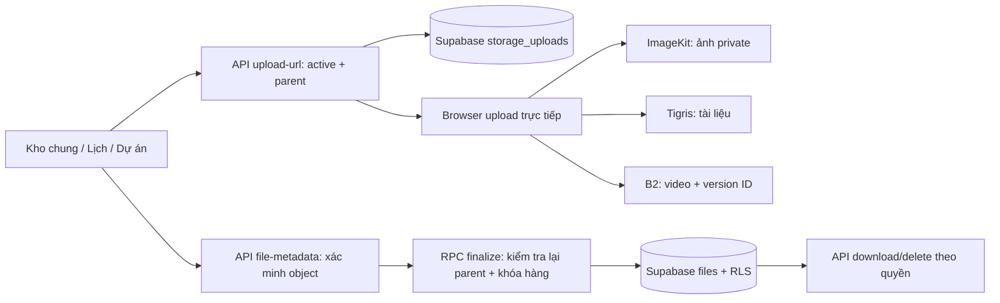

# Trạng thái kho FPC HUB — 17/11/2026

> FPCBackblaze2 đã thêm thành connection B2_02 (5353ffe3-b4f5-4bde-bf8d-ca780cd6ff71), bucket private FPCblackblaze2, endpoint s3.us-west-004.backblazeb2.com. Dùng key con FPC-HUB-B2-02 chỉ list/read/write/delete files, giới hạn bucket/prefix fpc-hub/. Key quản trị gửi trong chat chỉ giữ local, không đưa Netlify. Ngân sách nội bộ 8 GiB, cảnh báo 80%, dừng 90%; video: B2 cũ 10 → B2_02 15 → Tigris 20; tài liệu: Tigris 10 → B2 cũ 20 → B2_02 30. Local probe upload/private read/delete/CORS đạt, Netlify đã nhận 4 biến STORAGE_CONN_B2_02_*, đang redeploy để kiểm tra API cloud kết nối mới.

> https://fpc-hub-v15.netlify.app đã mở: Production Public, Deploy Preview Private (đã lưu qua dashboard và kiểm tra màn đăng nhập FPC). Gateway 5 API + scheduled storage-maintenance Node 22 đã deploy; cron 02:05 UTC = 09:05 Asia/Bangkok. 68 kiểm tra API thật trên Netlify đạt; 171 unit pass; 14 HTML/JS/CSS public không chứa key server. Tài khoản/tệp test đã dọn. Source app đang chạy e0a5245; nhánh phát hành codex/netlify-deploy chứa map mới.

## Đã triển khai kho xoay — 17/11/2026

- Supabase live: storage_pool_governance, storage_governance_schedule, storage_connection_identity và storage_pool_snapshot_accounting. Registry ba kết nối, quota từng user, ledger 24 giờ, jobs duyệt xóa và thông báo đã có thật; không còn bản nháp.
- Thêm tài khoản ImageKit/Tigris/B2 khác Gmail qua scripts/connect-storage.mjs; key lưu môi trường server riêng STORAGE_CONN_<NAME>_*. Supabase chỉ giữ endpoint/bucket/mã kết nối, không giữ secret. Probe upload/private read/delete/CORS trước đăng ký. Xem docs/STORAGE_CONNECT.md.
- 80% cảnh báo; 90% ngừng nhận mới, chọn kết nối kế tiếp theo ưu tiên loại tệp. Tệp cũ giữ storage_connection_id, provider, bucket và B2 version. Endpoint không được đổi khi còn tham chiếu; đăng ký trùng kho bị chặn. Dung lượng dựa metadata + phiếu chờ hoặc mức đã dùng nhập từ dashboard provider, không tự đo mọi soft-delete/version/băng thông.
- Mặc định mỗi user: 100 MiB/tệp (ảnh 10 MiB), 200 MiB/24 giờ, 50 phiếu/24 giờ, 500 MiB đang lưu; burst 20 phiếu/10 phút. Admin chỉnh từng người trong Kho tài nguyên. Ledger giữ 30 ngày; dọn phiếu không reset quota ngày.
- Sự kiện kết thúc quá 90 ngày chỉ tạo nhắc/chờ duyệt. Admin duyệt → chờ 7 ngày, thông báo người liên quan hoặc toàn CLB cho sự kiện public. Sự kiện private không phát toàn CLB. Yêu cầu giữ lại dừng lịch; thay đổi sự kiện làm job cần duyệt lại. Provider lỗi giữ metadata/sự kiện để retry, không báo xóa xong.
- Supabase pg_cron fpc-storage-governance đã bật 02:00 UTC = 09:00 Asia/Bangkok mỗi ngày: nhắc capacity/quota/tệp cũ/sự kiện quá 90 ngày, dọn ledger cũ. Đây là lịch chạy độc lập máy local, chưa tự xóa event.
- Worker xóa thật đã có ở api/_lib/storage-maintenance.ts. Admin có nút Dọn lịch đã duyệt và đến hạn; cron Vercel /api/storage-cleanup gọi cùng worker sau khi deploy + CRON_SECRET. Chưa deploy app/Vercel nên không hứa worker xóa chạy nền khi máy tắt. Không có sự kiện thật được duyệt hoặc xóa trong các bài kiểm thử.
- Kiểm tra hiện tại: TypeScript pass, 159 unit test; DB 52 assertion rollback; API thật 68 check ba provider + admin đạt, build pass; quét 170 tệp source/bundle không thấy secret server. Chrome chưa khả dụng qua công cụ trong phiên này nên chưa duyệt hình thức giao diện trực tiếp.
- Security advisor không báo function mới bị public execute; bảng quản trị mới cố ý service-only, bật RLS và thu hồi quyền client. Các cảnh báo cũ về touch_row, helper SECURITY DEFINER và leaked-password protection còn tồn tại; không tuyên bố toàn app đã sạch lỗi.

## Mốc trước kho xoay — các kiểm tra đã chạy

Đối chiếu Chrome B2: bucket FPCBackbalaze private/mã hóa, endpoint `https://s3.eu-central-003.backblazeb2.com`, region eu-central-003. Đã tạo FPC-HUB-storage theo xác nhận người dùng, bucket FPCBackbalaze/prefix fpc-hub/, preset Read and Write của B2 (gồm một số thao tác metadata bucket; không có quyền quản trị key/toàn tài khoản). Secret được lưu trực tiếp vào .env.local, không in vào chat. Khóa FPCB2 cũ giữ nguyên, không còn dùng trong app.

- Local: ảnh raster → ImageKit private; tài liệu → Tigris private; video → B2 private. Cả ba đã thử provider và API app thật, không phải chỉ kiểm tra có biến môi trường.
- Supabase lưu metadata, user/quyền và phiếu upload; file bytes đi trực tiếp browser → provider qua capability 5 phút. Không di chuyển tệp Supabase/B2/ImageKit/R2 cũ.
- Migration live: `20261117041023_secure_storage_uploads.sql`, `20261117044206_storage_metadata_provenance_guard.sql`.
- B2 migrations live: `20261117052611_b2_version_bound_uploads.sql`, `20261117064701_b2_version_validation.sql`. B2 không nhận If-None-Match trên PUT đã thử; server lấy version từ HeadObject, DB bắt buộc version hợp lệ và finalize idempotent, download/delete pin VersionId. Bản upload gửi lại không đổi nội dung đã chấp nhận; cleanup hết hạn dọn bản replay và giữ bản đã lưu.
- Phiếu gắn owner, parent, provider, bucket, đường dẫn, tên, MIME, size và hạn dùng. Chỉ active được xin phiếu; quyền parent kiểm tra lại khi finalize. Server xác minh object trước RPC finalize khóa hàng, replay trả cùng một file.
- Client không INSERT/UPDATE metadata hoặc gọi RPC tin cậy. Trigger DB chặn cả service API cũ tự chèn file không có session phù hợp. Database administrator SQL vẫn có quyền bảo trì.
- Metadata SELECT có RLS theo parent; API tải kiểm tra quyền rồi cấp link 5 phút. Xóa chỉ uploader active. Ảnh private dùng ImageKit V2 JWT ký đầy đủ payload; download lấy filePath từ provider, không ký public URL do client đưa.
- S3 PUT ký exact length/content type. Tigris dùng If-None-Match chống ghi đè; B2 pin version thay cho điều kiện này. ImageKit chỉ raster 10 MB, tệp khác 100 MB. Mỗi user tối đa 20 phiếu/10 phút, 200 MiB/ngày; quota nội bộ không tính ngay mọi bản B2 replay trước cleanup.
- CORS Tigris đã thêm PUT/GET/HEAD cho `http://127.0.0.1:5173` và `http://localhost:5173`, không thay rule cũ. API server chỉ phản hồi origin trong APP_ORIGINS; Bearer token vẫn bắt buộc.
- B2 CORS cũng giới hạn hai origin local, GET/HEAD/PUT; bucket vẫn private. Preflight thực tế trả 200. Dev server được sửa để reload env đúng và đã restart, tránh giữ provider/key cũ.
- Dev Vite phục vụ bốn API storage bằng SSR middleware, chỉ phía server được đọc secret. `npm run dev` nay dùng được luồng storage local.

## Kiểm tra và giới hạn

Kết quả sau nối B2: 141 unit test; 27 assertion DB storage rollback; API thật 43 kiểm tra, buộc video chọn B2, xác minh replay khác nội dung không thay bản đã finalize. Fixture Auth đã dọn. Các lượt trước đã kiểm tra build/secret scan và regression task/audit; build cuối chạy sau cập nhật map.

- TypeScript và test suite phải chạy sau mỗi sửa: `npm run typecheck`, `npm test`, `npm run build`.
- `db/tests/secure_storage_uploads.sql`: transaction rollback; 27 assertion phân quyền, giả owner/path, expiry, revoked approval, replay, ACL RPC, direct insert/update và B2 version bắt buộc/không đổi sau finalize.
- `node scripts/verify-storage-providers.mjs`: tạo tệp thử UUID dưới fpc-hub/_connection-tests trên cả ba kho, test upload/read/private và replay; dọn cả version thử B2. Đã PASS cả ba.
- `node scripts/verify-storage-app.mjs --pause-for-approval`: tạo Auth user @example.invalid, test pending/direct insert/API cũ service role/phiếu/finalize/replay/download/delete và cleanup hết hạn; xóa fixture sau test. Trigger profile hiện có từ chối service token không có sub khi đổi approval, nên runner in duy nhất ID fixture để duyệt bằng SQL quản trị; không bỏ trigger hoặc thay quyền thật để test.
- `node scripts/cleanup-storage-uploads.mjs`: dọn session bỏ dở hết hạn hơn 1 phút; với B2 hoàn tất thì dọn các version replay, giữ đúng version có metadata. Lỗi provider giữ trạng thái để retry. Không xóa file hoàn tất còn được tham chiếu.
- Cron `/api/storage-cleanup` mỗi ngày được khai báo trong vercel.json, yêu cầu CRON_SECRET. Đây là cấu hình local/chưa deploy; phải đặt secret ở môi trường Vercel trước khi dùng. Hạn mức đếm bởi app không phải cam kết hóa đơn: còn versions/soft delete/dữ liệu ngoài app và lượt request khác. Tigris đang bật soft delete 7 ngày.
- Không kiểm thử tải đồng thời 15 người, mạng chậm hoặc quota thực tế theo tháng. Chưa xác minh deployment Vercel, origin production hoặc cron chạy thật. Chưa sửa avatar placeholder, triển khai thông báo chat hay migration 0008 chat/lịch trong phiên này.

## Việc còn trước khi dùng chính thức

1. Thay các khóa đã dán trong chat; đặc biệt service-role Supabase. Lưu khóa mới trực tiếp trong môi trường server và secret manager, không qua chat/Git.
2. B2 đã hoàn tất cấu hình local, STORAGE_VIDEO_PROVIDER=b2. Khi deploy phải đưa đúng nhóm biến B2 và thêm origin production vào CORS; không fallback im lặng khi kho được chọn lỗi. Không cần gửi secret vào chat.
3. Đưa biến server lên Vercel, APP_ORIGINS đúng domain HTTPS, CRON_SECRET; deploy API/frontend cùng phiên bản và kiểm tra bằng hai tài khoản thật được cho phép test.
4. Rà soát/deploy migration 0008 chat/lịch và webhook thông báo riêng; test quyền thành viên/trưởng ban/lãnh đạo. Không coi việc có tệp SQL local là đã deploy.
5. Test avatar thật, đăng nhập/duyệt, chat hai thiết bị, lịch/dự án và một tuần sử dụng nhóm nhỏ. Chưa thể kết luận toàn app production-ready chỉ từ test storage.

## Quay lại nếu có lỗi

- Trước tiên xem provider/bucket đã lưu trên row; không sửa metadata để giả đổi nơi lưu.
- Tắt upload mới bằng cấu hình kho không sẵn sàng hoặc tạm dừng API; giữ đọc/xóa đã kiểm chứng. Không mở lại INSERT/UPDATE files cho authenticated hoặc bỏ provenance guard.
- Không rollback DB bằng reset/down toàn dự án. Dùng migration bù chỉ sửa đúng phần có lỗi, giữ dữ liệu cũ và guard. Nếu phục hồi frontend cũ, upload metadata cũ sẽ bị từ chối có chủ ý.
- Tệp lỗi chưa finalize: giữ session để retry trong hạn, hoặc dùng cleanup sau expiry. Theo dõi soft-deleted versions và quota tại dashboard provider.

